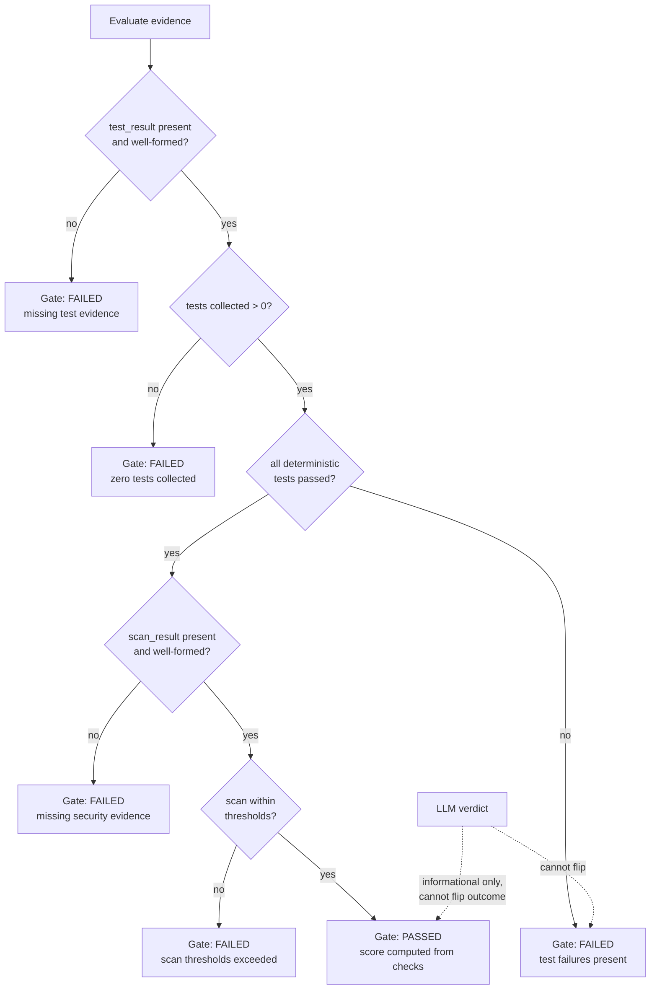
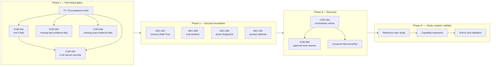

# AI Software Factory — Project Audit and Build Roadmap

> **Report status:** Phase 1 audit complete, Phase 1B verification complete — `READY FOR FIRST FIX`
> **Report date:** 14 October 2026
> **Repository:** [https://github.com/HeetVithalani/AI-Software-Factory](https://github.com/HeetVithalani/AI-Software-Factory)
> **Branch audited:** `master` (audited at commit `ddbde45` — "Update agent schemas, configuration, and factory tests")
> **Document path:** `docs/PROJECT_AUDIT_AND_BUILD_ROADMAP.md`

---

> **Post-milestone addendum (2026-10-17):** roadmap task 3.3 ("Consume
> `RecoveryPlan` on boot; reconcile `unresolved_task_ids`") is now implemented
> in substance via `factory/orchestration/boot.py::prepare_dag_for_execution`
> (checkpoint verification + durable task rows + explicit human resolution of
> uncertain tasks) and the `factory recovery status|resolve` commands. The
> original audit text below is preserved as the historical record. See
> `docs/FINAL_IMPLEMENTATION_STATUS.md`.

---

## A. Report Metadata and Executive Summary

### Metadata

| Item | Value |
|------|-------|
| Report date | 14 October 2026 |
| Repository | `https://github.com/HeetVithalani/AI-Software-Factory` |
| Default branch | `master` |
| Audit type | Read-only static source inspection (Phase 1) + read-only verification (Phase 1B) |
| Application code modified | **No** — this document is the only change introduced by the documentation task |
| Tests executed | **No** — no tests were run during the audit or verification |
| Runtime exploitability | **Not demonstrated** — all findings are source-level; no vulnerability was reproduced at runtime |
| Current audit status | Phase 1B concluded: **`READY FOR FIRST FIX`** |

### Scope and purpose

This document consolidates two completed activities:

1. **Phase 1 Audit** — a strictly read-only static inspection of the AI Software Factory codebase covering core modules, CLI, orchestration, agents, tools, permissions, LLM layer, audit/evidence, context/memory/research, configuration, and tests.
2. **Phase 1B Verification** — a narrowly scoped re-verification of the highest-risk findings, tracing each claim through its callers, downstream consumers, existing tests, and final quality/release decisions.

The purpose is to give a developer returning to this project a precise, evidence-backed picture of what exists, what is broken, what is unverified, and the smallest safe path to the first fix.

### Evidence classification used throughout

| Classification | Meaning |
|----------------|---------|
| **Confirmed by source** | Direct code evidence supports the claim (function bodies, callers, and downstream use traced). |
| **Partially confirmed** | Some code supports the claim, but protective logic elsewhere weakens or qualifies it. |
| **Initial-audit follow-up** | Reported in the Phase 1 audit but not re-verified in Phase 1B; requires further inspection. |
| **Not dynamically reproduced** | No test or runtime execution was performed; **all findings are `NOT RUNTIME VERIFIED`**. |

### Executive summary

The AI Software Factory is an ambitious local-first, multi-agent software engineering factory with a well-structured skeleton: a DAG orchestrator, permission broker, risk engine, deterministic quality gate, audit/evidence layer, and a pluggable LLM router. However, the verification concluded that **the quality gates currently fail open** and **several security boundaries are incomplete**, so the system can report false success and execute or authorize operations more loosely than intended.

The nine verified findings fall into three groups:

- **False-success gates (P0):** zero collected tests are treated as success (COR-001); an LLM verdict can override deterministic test failures (COR-002); missing test evidence (COR-005) and missing security-scan evidence (COR-006) vacuously pass the quality gate.
- **Security boundaries (P0):** `shell=True` execution of model-generated commands (SEC-002); the request sanitizer is a pass-through (SEC-008); approval inheritance does not fingerprint the full action (SEC-006); symlink/junction defense-in-depth is absent (SEC-001, *partially confirmed*).
- **Recovery gaps (P1):** approval grants do not auto-resume work (COR-003); declared retry behavior (`retry_count`, `max_retries`, `recovery_strategy`) is never applied by the orchestrator (COR-004).

Phase 1B concluded **`READY FOR FIRST FIX`**: all nine findings have direct source evidence, and the first remediation (fail-closed quality gates) is isolated and testable with acceptance tests T1–T6 defined in Section G.

**Critical distinction:** every statement in this report comes from reading source code. No tests were executed, no vulnerability was reproduced, and no finding is claimed as a confirmed runtime exploit. Line numbers are **audit-time references** and may shift as the code changes.

---

## B. Project Vision and Engineering Principles

### Vision

The AI Software Factory aims to be a **reliable, local-first, multi-agent AI software engineering factory**: a system where specialized agents (planner, builder, reviewer, QA, security, documentation, auditor) collaborate through a deterministic DAG orchestrator, use tools through a permission broker, and produce auditable evidence for every significant decision — with local model usage by default (Ollama) and provider flexibility (e.g., OpenCode-compatible endpoints).

### Engineering principles governing development

These principles were used as the audit yardstick, and the verified findings are largely violations of them:

1. **Deterministic evidence overrides LLM opinions.** Tool outputs, test results, and scan results are ground truth. LLM evaluation adds interpretation, never flips a deterministic failure into success. *(Violated by COR-002, COR-007.)*
2. **Missing required evidence fails closed.** If test evidence or security-scan evidence is absent, the gate must fail — not score 100 by vacuity. *(Violated by COR-005, COR-006.)*
3. **Least privilege and operation-specific approvals.** An approval covers the specific operation reviewed, not merely a category-plus-target combination. *(Violated by SEC-006.)*
4. **Safe tool execution.** Model-generated commands run without a shell where possible, inside the workspace sandbox, with symlink/junction defense-in-depth. *(Violated by SEC-002; partially addressed for SEC-001.)*
5. **Local-first model usage with provider flexibility.** Sensitive content must not reach remote providers unredacted. *(Violated by SEC-008.)*
6. **Incremental, test-driven changes.** Every fix lands with regression tests; acceptance tests precede implementation. *(Currently missing for the first fix — see Section G.)*
7. **Auditable task state and recovery.** Declared retry/recovery behavior must actually be executed by the orchestrator, and state transitions recorded. *(Violated by COR-003, COR-004.)*
8. **Preserve existing work; avoid unnecessary rewrites.** Remediation proceeds in small, verified steps on top of the existing architecture rather than replacing it.

---

## C. Existing Architecture

The following describes **only what is supported by source inspection and the repository's own documentation** (`CODEBASE_STRUCTURE_SUMMARY.md`, module docstrings). Status labels distinguish existing, incomplete, and proposed capabilities.

### C.1 Agents (`factory/agents/`)

| Agent | File | Status | Notes |
|-------|------|--------|-------|
| Planner | `planner.py` | Exists | Produces plans via LLM; plan loader/CLI present. |
| Builder | `builder.py` | Exists | Emits `ToolCallProposal`s executed through the tool layer. |
| Reviewer | `reviewer.py` | Exists | LLM review after deterministic checks; **same override pattern as QA (COR-007, follow-up)**. |
| QA | `qa.py` | Exists, **defective** | Runs `TestingTool`, then lets LLM verdict decide success (COR-002). |
| Security | `security.py` | Exists, **defective** | Runs `SecurityTool`, then LLM `approved` flag decides success (COR-007). |
| Documentation | `documentation.py` | Exists | Documentation generation. |
| Auditor | `auditor.py` | Exists | Emits audit evidence; LLM-assisted (COR-007 follow-up). |

All agents extend `BaseAgent` (`agents/base.py`) with `_ok`/`_fail`/`_emit` helpers. The QA and Security agents record deterministic results in their reports but **do not use them for the final `AgentResult.success` decision** (see Section E, COR-002).

### C.2 LLM / provider routing (`factory/llm/`)

- `provider.py` — `LLMRequest`/`LLMResponse` abstractions.
- `ollama.py` — local Ollama provider (local-first default).
- `router.py` — routes requests to configured providers; calls `sanitize_request()` before dispatch (**currently a no-op**, SEC-008).
- `retry.py`, `structured_output.py` — retry handling and schema-constrained output parsing.
- `schemas/` — structured proposals (`qa.QAProposal`, security approval, etc.).
- `sanitizer.py` — **pass-through stub**, see Section E (SEC-008).

**Status:** routing and structured output exist; request sanitization is **proposed/not implemented**.

### C.3 Tools (`factory/tools/`)

| Tool | File | Status | Notes |
|------|------|--------|-------|
| Filesystem | `filesystem.py` + `base.py` | Exists | `_sandbox_path()` enforces workspace containment via `Path.resolve()` + `relative_to()`; no explicit symlink/junction detection (SEC-001, partially confirmed). |
| Shell | `shell.py` | Exists, **defective** | RiskEngine classification + broker approval before exec, but executes with `subprocess.run(command, shell=True)` (SEC-002). |
| Git | `git.py` | Exists | Parent-repository interaction concern (SEC-004, follow-up). |
| Testing | `testing.py` | Exists, **defective** | Pytest subprocess runner; returncode 5 ("no tests collected") treated as success (COR-001). |
| Security | `security.py` (tools) | Exists | Workspace scan producing `ScanResult` consumed by the quality gate. |
| Browser | `browser.py` | Exists | SSRF/DNS-rebinding/redirect concerns (SEC-003, follow-up). |

### C.4 Permissions and approvals (`factory/permissions/`)

- `risk.py` — deterministic `RiskEngine` with explicit rule tables (SAFE → CRITICAL). No LLM involvement.
- `policies.py` — policy loading from `configs/policies.yaml`; weakening "non-negotiable" settings currently only warns (SEC-007, follow-up).
- `broker.py` — `PermissionBroker` mediates tool execution against risk level and approvals.
- `approvals.py` — `ApprovalManager` with scope inheritance (`_make_scope_key`, `_ScopeEntry.covers`). **Scope key hashes only `action_category + target`, not the full action** (SEC-006).
- `sensitive_data.py` — `SensitiveDataDetector` used at file read/write boundaries.

### C.5 Orchestration and DAG execution (`factory/orchestration/`)

- `orchestrator.py` — `Orchestrator.step()` executes ready nodes synchronously; on failure marks the task `FAILED` **immediately without consulting `retry_count`/`max_retries`/`recovery_strategy`** (COR-004).
- `dag.py` — task graph with status updates.
- `scheduler.py` — ready-task scheduling.
- `recovery.py` — `RecoveryManager.recover()` produces a `RecoveryPlan`, but **no caller consumes the plan to re-queue tasks** (COR-003/COR-004 follow-up).
- `routing.py` — agent-type routing for tasks.

### C.6 Quality gates (`factory/projects/quality.py`)

`QualityGate.evaluate(test_result, scan_result)` is deterministic: it compares thresholds from `Requirements` against test and scan results, then computes a score.

**Status: exists but fails open.** Checks are only evaluated `if test_result is not None` / `if scan_result is not None`; when no checks run, `score = 100.0` and `passed = (len(failures) == 0) == True` (COR-005, COR-006).

### C.7 State / database (`factory/state.py`, `factory/database.py`)

- SQLite schema v3; `StateManager` persists snapshots (`kernel_state`) and boots with `boot_state()`, which clears active tasks, sets `paused`, and stores unresolved task IDs.
- **Incomplete:** nothing re-queues `unresolved_task_ids` automatically (COR-003 follow-up).
- **Follow-up:** SQLite isolation across projects requires further verification.

### C.8 Evidence / audit (`factory/audit/`)

- `logger.py` — structured audit event emission (`task.completed`, `task.failed`, etc.).
- `evidence.py` — evidence capture/hashing (test output hashing exists in `TestingTool`).
- `reports.py` — report generation.
- **Status:** exists and is wired into the orchestrator and tools; depth of coverage beyond event emission requires follow-up verification.

### C.9 Dashboard / API

**Status: stubs.** Dashboard/API endpoints are not fully implemented; treat as proposed capability. (See Section F register.)

---

## D. Audit Methodology and Limitations

### What was inspected

- **Phase 1:** static reading of `factory/` core (`config.py`, `database.py`, `models.py`, `state.py`, `errors.py`, `events.py`), CLI (`cli/main.py`, `plan_loader.py`, `approvals_cmd.py`), orchestration, all agents, all tools, permissions, LLM layer, audit layer, context/memory/research/projects modules, `configs/` (`factory.yaml`, `models.yaml`, `policies.yaml`, profiles), `tests/` (unit/integration/e2e), `pyproject.toml`.
- **Phase 1B:** for each of the nine in-scope findings — located the implementation, read the complete function **and its callers**, traced the result to the final quality/release decision, inspected existing tests for support/contradiction, checked for protective logic elsewhere, and considered Windows-specific behavior.

### Restrictions observed

- Read-only throughout: **no file modifications, no dependency installs, no network, no LLM calls, no servers, no subagents**.
- **No tests were executed** and no application code was run.
- Excluded: `projects\CloudSense`, `.env`/secrets, `factory.db` contents, `.git`/`.venv`/`node_modules`, caches, logs, backups.
- PowerShell on the audit host rejects `&&`/`||` separators (tooling note only).

### What was NOT verified

- **Nothing is runtime verified.** Every finding is marked `NOT RUNTIME VERIFIED`. Source-level confirmation is not proof of runtime exploitability.
- No dynamic reproduction of any security finding (no exploit attempts were made).
- Windows junction/symlink behavior was reasoned about statically only (SEC-001).
- Integration/E2E test suites were read, not run.
- Line numbers are audit-time references and may drift with future commits.

### Methodology rules applied

- A possible vulnerability was **never silently upgraded** into a confirmed exploit.
- Where protective logic elsewhere weakened a claim, the finding was downgraded or qualified (see Section E corrections — notably SEC-001).

---

## E. Phase 1B Findings Matrix

Statuses used: `CONFIRMED BY SOURCE`, `PARTIALLY CONFIRMED`. **All findings are `NOT RUNTIME VERIFIED`.**
Line references are audit-time references and may shift.

### E.1 COR-001 — Zero collected tests may be treated as success

| Field | Detail |
|-------|--------|
| **Finding ID** | COR-001 |
| **Priority** | P0 |
| **Verification status** | `CONFIRMED BY SOURCE` — `NOT RUNTIME VERIFIED` |
| **Description** | `TestingTool.run_tests()` returns `success=True` when pytest exits with code 5 ("no tests collected"). A project with an empty test suite therefore passes QA. |
| **Technical evidence** | `factory/tools/testing.py` — `run_tests()`: `success = proc.returncode in (0, 5)` (returncode 5 explicitly treated as "not a failure"), combined with `success=success and test_result.all_passed`; an empty suite yields `all_passed=True`. Downstream: `factory/projects/quality.py` — `evaluate()` sets `score = 100.0` when `total_checks == 0`, so no failures → `passed=True`. |
| **Source file / function** | `factory/tools/testing.py` → `run_tests()`; `factory/projects/quality.py` → `evaluate()` |
| **Actual impact** | The factory can claim "all tests passed" for untested code — a false-success quality gate. |
| **Existing test coverage** | `tests/unit/test_tools.py` — `test_run_tests_no_tests_collected` **explicitly asserts current (wrong) behavior**: treats returncode 5 as success. |
| **Missing regression test** | A test asserting that a zero-test collection **fails** the tool result and the quality gate (see T1, Section G). The existing test must be inverted as part of the fix. |
| **Recommended action** | Returncode 5 → `success=False` in `run_tests()`; quality gate must require at least one collected test. |

### E.2 COR-002 — LLM QA result can override deterministic test failure

| Field | Detail |
|-------|--------|
| **Finding ID** | COR-002 |
| **Priority** | P0 |
| **Verification status** | `CONFIRMED BY SOURCE` — `NOT RUNTIME VERIFIED` |
| **Description** | `QAAgent.run()` executes tests deterministically, then asks the LLM for a `QAProposal`. The final `AgentResult.success` is decided by `proposal.all_passed` (LLM), **not** by the deterministic tool result. |
| **Technical evidence** | `factory/agents/qa.py` → `run()`: `testing_tool.run_tests()` result is recorded into the report (`result.success` stored in outputs), but the return value is chosen by `if proposal.all_passed: return self._ok(...)` else `self._fail(...)`. The deterministic `result.success` is never consulted for the decision. |
| **Source file / function** | `factory/agents/qa.py` → `QAAgent.run()` |
| **Actual impact** | An LLM hallucination, truncated context, or malformed structured output can mask real test failures → false success. |
| **Existing test coverage** | `tests/unit/test_agents.py` — `TestQAAgent` uses `mock_llm_router_with_qa` (fixture in `tests/unit/conftest.py`), which derives `all_passed` **from the test name** — not from actual test execution. No test covers "LLM says pass while tests fail". |
| **Missing regression test** | Mock LLM returning `all_passed=True` while `TestingTool` reports failures; assert `AgentResult.success is False` (see T6, Section G). |
| **Recommended action** | Make `AgentResult.success` derive from the deterministic tool result; LLM evaluation contributes findings/summary only. |

### E.3 COR-005 — Missing test evidence can pass the quality gate

| Field | Detail |
|-------|--------|
| **Finding ID** | COR-005 |
| **Priority** | P0 |
| **Verification status** | `CONFIRMED BY SOURCE` — `NOT RUNTIME VERIFIED` |
| **Description** | `QualityGate.evaluate(test_result=None)` skips all test checks; with zero checks it scores 100 and passes. |
| **Technical evidence** | `factory/projects/quality.py` → `evaluate()`: test checks run only `if test_result is not None`; scoring block: `if total_checks > 0: score = checks_passed/total_checks*100 else: score = 100.0`; `passed = len(failures) == 0`. |
| **Source file / function** | `factory/projects/quality.py` → `evaluate()` |
| **Actual impact** | Tool execution failures (pytest missing, timeout, crash) silently pass the gate. |
| **Existing test coverage** | None — no test calls `evaluate()` with `test_result=None`. |
| **Missing regression test** | Missing test evidence must produce `passed=False` with an explicit failure reason (see T3, Section G). |
| **Recommended action** | Require explicit `test_result` with expected keys; absent evidence = failure (fail closed). |

### E.4 COR-006 — Missing security-scan evidence can pass the quality gate

| Field | Detail |
|-------|--------|
| **Finding ID** | COR-006 |
| **Priority** | P0 |
| **Verification status** | `CONFIRMED BY SOURCE` — `NOT RUNTIME VERIFIED` |
| **Description** | Same fail-open pattern as COR-005 for the security side: `evaluate(scan_result=None)` skips security checks and vacuously passes. |
| **Technical evidence** | `factory/projects/quality.py` → `evaluate()`: security checks run only `if scan_result is not None`; same `total_checks == 0 → score 100 → passed=True` path. |
| **Source file / function** | `factory/projects/quality.py` → `evaluate()` |
| **Actual impact** | Security tool failures (permission error, timeout, crash) do not block release. |
| **Existing test coverage** | None — no test calls `evaluate()` with `scan_result=None`. |
| **Missing regression test** | Missing scan evidence must fail the gate (see T4, Section G). |
| **Recommended action** | Require explicit `scan_result` with expected keys; absent evidence = failure. |

### E.5 SEC-002 — Shell execution with `shell=True`

| Field | Detail |
|-------|--------|
| **Finding ID** | SEC-002 |
| **Priority** | P0 |
| **Verification status** | `CONFIRMED BY SOURCE` — `NOT RUNTIME VERIFIED` |
| **Description** | Model-generated command strings execute via `subprocess.run(command, shell=True, ...)`. Shell metacharacters in an approved command string are interpreted by the shell. |
| **Technical evidence** | `factory/tools/shell.py` → `ShellTool.run()`: `subprocess.run(command, shell=True, capture_output=..., timeout=...)`. Preceding defenses: RiskEngine classification and PermissionBroker approval gate the *request*, but once approved the full string is shell-interpreted. Command originates from `ToolCallProposal.arguments["command"]` (builder agent). On Windows, `shell=True` routes through `cmd.exe`, with different metacharacter semantics (`&`, `|`, `%VAR%`). |
| **Source file / function** | `factory/tools/shell.py` → `ShellTool.run()` |
| **Actual impact** | If an approval is granted (or inherited — see SEC-006), arbitrary shell constructs execute beyond the reviewed intent. |
| **Existing test coverage** | `tests/unit/test_tools.py` covers risk refusal (e.g., `rm -rf` refused when risky) but **not** injection through an approved string. |
| **Missing regression test** | Approved-string injection test: e.g., an approved `echo` carrying a `;`-chained second command must not execute the second command (or must require separate approval). |
| **Recommended action** | Prefer `shell=False` with an argv list; require structured `command` + `args` in proposals; where shell features are required, parse and validate explicitly. |

### E.6 SEC-008 — Request sanitizer is a pass-through

| Field | Detail |
|-------|--------|
| **Finding ID** | SEC-008 |
| **Priority** | P0 |
| **Verification status** | `CONFIRMED BY SOURCE` — `NOT RUNTIME VERIFIED` |
| **Description** | `sanitize_request()` performs no scanning or redaction; it returns the request unchanged. |
| **Technical evidence** | `factory/llm/sanitizer.py` → `sanitize_request()`: docstring says "strip it or reject it based on policy", body is a comment ("For Phase 2… basic pass-through") followed by `return request`. Called from `factory/llm/router.py` (`LLMRouter.complete()`), so every prompt goes through the no-op. The comment delegates protection to `SensitiveDataDetector` at the file read/write boundary — which only covers files, not content composed into prompts by other means (e.g., tool output, task metadata). |
| **Source file / function** | `factory/llm/sanitizer.py` → `sanitize_request()` |
| **Actual impact** | Sensitive content present in prompt material can reach the configured provider; with a remote provider (e.g., OpenCode-compatible endpoint) this is a data-exposure path. |
| **Existing test coverage** | None — no tests for `sanitize_request()`. |
| **Missing regression test** | Prompt containing a secret-pattern string must be redacted or rejected before dispatch. |
| **Recommended action** | Implement content scanning in `sanitize_request()` reusing `SensitiveDataDetector` patterns; redact or reject per policy. |

### E.7 SEC-001 — Symlink/junction sandbox defense-in-depth *(partially confirmed)*

| Field | Detail |
|-------|--------|
| **Finding ID** | SEC-001 |
| **Priority** | P1 (defense-in-depth; downgraded from initial P0 claim) |
| **Verification status** | `PARTIALLY CONFIRMED` — `NOT RUNTIME VERIFIED` |
| **Description** | `_sandbox_path()` relies solely on `Path.resolve()` followed by `relative_to(root)`. There is no explicit symlink/junction detection. |
| **Technical evidence** | `factory/tools/base.py` → `_sandbox_path()`: resolves relative paths against `workspace_root`, then `resolved.relative_to(root)` → `ToolError` on escape. **Qualification (Phase 1B correction):** on Windows, `Path.resolve()` follows symlinks and junctions, so a link pointing outside the workspace resolves to an outside path and the `relative_to()` check **would reject it**. The check therefore likely catches the basic escape case. The residual risk is defense-in-depth: no explicit detection of reparse points, race windows between check and use (TOCTOU), and edge cases (links whose target is itself under the root, case/short-name normalization differences on Windows). |
| **Source file / function** | `factory/tools/base.py` → `_sandbox_path()` |
| **Actual impact** | Basic junction escape is likely blocked by the resolve+contain check; residual exposure is TOCTOU/normalization edge cases. Lower severity than initially stated. |
| **Existing test coverage** | `tests/unit/test_tools.py` covers `..` traversal and absolute-path escapes; **no symlink/junction tests**. |
| **Missing regression test** | Windows-specific: create a junction inside the workspace pointing outside; assert `ToolError` on read/write through it; plus a TOCTOU-oriented check if feasible. |
| **Recommended action** | Add explicit reparse-point/symlink detection before resolve (defense-in-depth), and re-verify on Windows with a dedicated test. Do **not** treat as a demonstrated bypass. |

### E.8 SEC-006 — Approval inheritance does not fingerprint the full action

| Field | Detail |
|-------|--------|
| **Finding ID** | SEC-006 |
| **Priority** | P0 |
| **Verification status** | `CONFIRMED BY SOURCE` — `NOT RUNTIME VERIFIED` |
| **Description** | Scope inheritance keys on `action_category + target` only; the concrete action string is not part of the key, so a materially different operation in the same category/target can inherit a prior approval. |
| **Technical evidence** | `factory/permissions/approvals.py` → `_make_scope_key(action_category, target)`: `sha1(f"{category}::{target}")[:16]` — action string excluded. `_ScopeEntry.covers()` requires: same category, same scope key, risk ≤ approved ceiling, `grants_scope_inheritance=True`. Example: approving `git commit -m "feat: login"` then requesting `git commit -m "feat: backdoor"` on the same target produces the same scope key → second operation inherits approval without review. |
| **Source file / function** | `factory/permissions/approvals.py` → `_make_scope_key()`, `_ScopeEntry.covers()` |
| **Actual impact** | A human reviews operation A; operation B (different content, same category/target/risk) runs under A's approval — an unauthorized-operation path. |
| **Existing test coverage** | `tests/unit/test_permissions.py` — inheritance tests cover category mismatch, target mismatch, and risk ceiling, but **no test for same category+target with a different action string**. |
| **Missing regression test** | Approve action X; request materially different action Y in same category+target; assert fresh approval required. |
| **Recommended action** | Include an action fingerprint (hash of the normalized action/arguments) in the scope key, or disable inheritance for action categories where parameterization matters (git mutations, shell commands). |

### E.9 COR-003 — Approval grant does not automatically resume work

| Field | Detail |
|-------|--------|
| **Finding ID** | COR-003 |
| **Priority** | P1 |
| **Verification status** | `CONFIRMED BY SOURCE` — `NOT RUNTIME VERIFIED` |
| **Description** | After a human grants an approval via the CLI, nothing resumes the paused/failed workflow; the user is told to re-run manually. |
| **Technical evidence** | `factory/cli/approvals_cmd.py` → `cmd_approvals_grant()`: on success prints guidance equivalent to "Re-run the failed task to continue" — no signal to a running orchestrator. `factory/state.py` → `StateManager.boot_state()`: clears active tasks, sets `paused`, stores `unresolved_task_ids` in extra state — but no consumer re-queues them. `factory/orchestration/recovery.py` → `RecoveryManager.recover()` builds a `RecoveryPlan` that **no caller consumes**. |
| **Source file / function** | `factory/cli/approvals_cmd.py` → `cmd_approvals_grant()`; `factory/state.py` → `boot_state()`; `factory/orchestration/recovery.py` → `recover()` |
| **Actual impact** | Approved tasks do not continue autonomously; the "factory" requires manual re-runs at every approval boundary. Reliability/UX gap, not a security defect. |
| **Existing test coverage** | None for auto-resume. |
| **Missing regression test** | Grant approval → orchestrator resumes and dispatches the previously blocked task. |
| **Recommended action** | On grant, if state is paused with matching pending approval, re-queue the blocked task; wire `RecoveryPlan` consumption on boot. |

### E.10 COR-004 — Declared retry behavior is not applied by the orchestrator

| Field | Detail |
|-------|--------|
| **Finding ID** | COR-004 |
| **Priority** | P1 |
| **Verification status** | `CONFIRMED BY SOURCE` — `NOT RUNTIME VERIFIED` |
| **Description** | `TaskRecord` declares `retry_count`, `max_retries` (default 3), and `recovery_strategy` (default `RETRY_SAME`), but the orchestrator never consults them: the first failure marks the task `FAILED` permanently. |
| **Technical evidence** | `factory/models.py` → `TaskRecord`: fields `retry_count: int = 0`, `max_retries: int = 3`, `recovery_strategy: RecoveryStrategy = RETRY_SAME` exist; `mark_failed()` increments `retry_count`. `factory/orchestration/orchestrator.py` → `step()`: on `result.success == False` → `dag.update_status(task_id, FAILED)` + audit event + `scheduler.complete()` — **no check of `retry_count < max_retries`, no re-queue, no recovery strategy application**. |
| **Source file / function** | `factory/orchestration/orchestrator.py` → `step()`; `factory/models.py` → `TaskRecord` |
| **Actual impact** | Transient failures (timeouts, temporary tool errors) permanently fail tasks; declared recovery behavior is dead configuration. |
| **Existing test coverage** | No integration test exercises retry/recovery end-to-end (integration recovery tests are minimal, including a placeholder). |
| **Missing regression test** | Task fails with retries remaining → re-queued and re-dispatched; retries exhausted → FAILED permanently. |
| **Recommended action** | In `step()`, on failure: if `retry_count < max_retries`, apply `recovery_strategy` and re-queue; else mark FAILED. Emit audit events for retry attempts. |

### E.11 Phase 1B corrections and qualifications to the initial audit

| Initial-audit statement | Phase 1B correction |
|-------------------------|---------------------|
| SEC-001 stated as a likely sandbox bypass via symlinks/junctions. | **Downgraded to PARTIALLY CONFIRMED.** `Path.resolve()` + `relative_to(root)` likely blocks the basic outside-pointing link case because the resolved path falls outside the root. Residual concern is defense-in-depth (no explicit reparse-point detection, TOCTOU, Windows normalization edge cases). |
| COR-007 phrased as "multiple agents override failures". | **Precisely scoped:** the pattern is in agents that run a deterministic tool and then delegate the success decision to an LLM verdict — QA (`qa.py`) and Security (`security.py`), with Reviewer and Auditor following the same shape (follow-up, Section F). |
| COR-001 implied the gate "silently" passes empty suites. | Correct, but note the existing unit test **encodes the wrong behavior deliberately** (comment: returncode 5 treated as success) — the fix must invert that test. |
| Initial severity of SEC-002 treated approval as the only mitigation. | Nuance: RiskEngine + broker are real protective logic and do gate requests; the defect is that approval covers a *string* that the shell may interpret more broadly than reviewed, and SEC-006 weakens approval granularity further. |
| Runtime exploitability. | **Nothing reproduced.** All findings remain `NOT RUNTIME VERIFIED`; source confirmation only. |

---

## F. Initial-Audit Follow-Up Register

These items were reported in the Phase 1 audit but were **not** part of the Phase 1B verification scope. They retain their initial-audit status and **require further verification** before being treated as confirmed.

| ID | Description | Current status | Evidence so far | Next verification step |
|----|-------------|----------------|-----------------|------------------------|
| **COR-007** | Later agents (Reviewer, Auditor, Security) may override deterministic failures with an LLM verdict, same shape as COR-002. | Initial-audit follow-up; **pattern confirmed for QA/Security by source reading**, Reviewer/Auditor not re-traced in 1B. | `agents/qa.py`, `agents/security.py` show the pattern; `agents/reviewer.py`, `agents/auditor.py` read similarly in Phase 1. | Trace `reviewer.py`/`auditor.py` success decisions against their deterministic inputs; add T6-style test per agent. |
| **COR-008** | `has_unrecoverable_failure()` does not consider `retry_count`/`recovery_strategy`. | Initial-audit follow-up. | Phase 1 reading of orchestration failure predicates. | Re-read failure-classification path after COR-004 fix lands (dependency). |
| **SEC-003** | Browser tool SSRF: DNS resolved once for private-IP check, then again by the HTTP client; redirects not re-validated (TOCTOU / DNS rebinding). | Initial-audit follow-up. | Phase 1 reading of `tools/browser.py` (`_is_private_host()` pattern). | Verify redirect handling and per-hop IP pinning; test with controlled DNS. |
| **SEC-004** | Git operations may affect a parent repository when the workspace sits inside an existing repo. | Initial-audit follow-up. | Phase 1 reading of `tools/git.py` (`is_git_repo()` checks workspace, not ancestors). | Inspect git invocation cwd/`-C` usage and ancestor `.git` detection. |
| **SEC-005** | Windows protected-path coverage (e.g., `C:\Windows`, `System32`) in sensitive-path rules. | Initial-audit follow-up — **unverified**. | Phase 1 note only. | Inspect sensitive-path rule tables for Windows system paths. |
| **SEC-007** | Weakening a "non-negotiable" policy setting only emits a warning and continues. | Initial-audit follow-up. | Phase 1 reading of `permissions/policies.py` (`warnings.warn` path). | Verify whether any caller escalates to hard failure; convert to `ConfigurationError` if confirmed. |
| **DASH-001** | Dashboard/API endpoints are stubs. | Initial-audit follow-up. | Phase 1 repo inventory. | Inventory API routes vs. documented behavior; mark implemented vs. stub. |
| **DB-001** | SQLite isolation across projects (shared DB file, per-project scoping). | Initial-audit follow-up — **unverified**. | Phase 1 schema reading (schema v3). | Verify query scoping by `project_id` across repositories. |

> Rule: **no item in this table may be cited as confirmed until verified.** Do not silently upgrade these into established defects.

---

## G. Acceptance Tests for the First Fix

The following six tests define the acceptance criteria for **Phase 1: fail-closed quality gates** (COR-001, COR-002, COR-005, COR-006). They are **proposals only** — they have not been written or run. Signatures/names may require adaptation to the actual APIs when implemented (e.g., `TestingTool` constructor arguments, `QualityGate.evaluate()` parameters, mock router fixtures).

### T1 — Zero tests collected must fail

- **Scenario:** workspace with no discoverable tests; pytest exits with code 5.
- **Expected result:** `TestingTool.run_tests()` → `ToolResult.success = False` (returncode 5 no longer accepted); downstream `QualityGate.evaluate()` → `passed = False` with an explicit failure reason.
- **Code path protected:** `factory/tools/testing.py` → `run_tests()` (returncode acceptance logic) and `factory/projects/quality.py` → `evaluate()` (vacuous-score branch).
- **Note:** the existing `tests/unit/test_tools.py::test_run_tests_no_tests_collected` asserts the opposite and must be inverted with the fix.

### T2 — A real failing test must fail

- **Scenario:** workspace contains a test that genuinely fails; pytest exits non-zero with ≥1 failed test.
- **Expected result:** `ToolResult.success = False`; `test_result.failed ≥ 1`; `QualityGate.evaluate()` → `passed = False` with the failure surfaced in `failures`.
- **Code path protected:** `testing.py` result parsing (`all_passed` combination) and `quality.py` test threshold checks.
- **Note:** a passing-test control case must also remain green (no regression).

### T3 — Missing test evidence must fail

- **Scenario:** `QualityGate.evaluate()` called with `test_result = None` (or a dict missing required keys).
- **Expected result:** `passed = False` with a failure such as "missing test evidence"; `score` must **not** default to 100.
- **Code path protected:** `factory/projects/quality.py` → `evaluate()` (the `if test_result is not None` guard and the `total_checks == 0 → score 100` branch).

### T4 — Missing security-scan evidence must fail

- **Scenario:** `QualityGate.evaluate()` called with `scan_result = None` (or missing required keys).
- **Expected result:** `passed = False` with a failure such as "missing security scan evidence".
- **Code path protected:** `factory/projects/quality.py` → `evaluate()` (the `if scan_result is not None` guard and vacuous-score branch).

### T5 — A tool execution failure must return a controlled error

- **Scenario:** test executable missing/unusable (e.g., invalid `python_executable`), pytest cannot run.
- **Expected result:** `ToolResult.success = False` with a descriptive error (executable/pytest not found) — **no unhandled exception**, and the resulting absence of evidence propagates to a failed gate (T3).
- **Code path protected:** `factory/tools/testing.py` → `run_tests()` error handling around subprocess launch, plus the evidence-to-gate linkage.

### T6 — An LLM positive verdict must not override deterministic failure

- **Scenario:** workspace with a genuinely failing test; the LLM (mocked) returns `QAProposal(all_passed=True, failed_tests=[])`.
- **Expected result:** `QAAgent.run()` → `AgentResult.success = False` (deterministic result wins); the report still records the LLM's opinion, but it cannot flip the outcome; downstream gate fails.
- **Code path protected:** `factory/agents/qa.py` → `run()` (the `if proposal.all_passed:` success decision).
- **Note:** the current fixture `mock_llm_router_with_qa` derives `all_passed` from the test name; T6 needs a mock that **lies** (claims success despite real failures).

### Acceptance-test matrix (summary)

| Test | Scenario | Expected outcome | Protects | Finding |
|------|----------|------------------|----------|---------|
| T1 | Zero tests collected | Tool + gate fail | `testing.py`, `quality.py` | COR-001 |
| T2 | Real failing test | Tool + gate fail | `testing.py`, `quality.py` | COR-001/COR-005 |
| T3 | Missing test evidence | Gate fails | `quality.py` | COR-005 |
| T4 | Missing scan evidence | Gate fails | `quality.py` | COR-006 |
| T5 | Tool execution failure | Controlled error → gate fails | `testing.py` error path | COR-005 |
| T6 | LLM claims success on failure | Agent still fails | `qa.py` | COR-002 |

---

## H. Remediation Roadmap

**Why reliability and security precede increased autonomy:** adding more agents or autonomy on top of gates that fail open multiplies false successes and unauthorized operations. The sequence below first makes the factory's verdicts trustworthy (fail closed), then hardens its boundaries, then restores recovery — only then does capability expansion make sense.

### Phase 1 — Fail-closed quality gates *(first milestone)*

| # | Change | Finding | Depends on |
|---|--------|---------|------------|
| 1.1 | `TestingTool.run_tests()`: treat returncode 5 (no tests collected) as failure; invert the existing wrong test. | COR-001 | — |
| 1.2 | `QualityGate.evaluate()`: require explicit, well-formed `test_result`; missing/malformed = failure. | COR-005 | — |
| 1.3 | `QualityGate.evaluate()`: require explicit, well-formed `scan_result`; missing/malformed = failure. | COR-006 | — |
| 1.4 | `QAAgent.run()`: `AgentResult.success` derives from the deterministic tool result; LLM verdict is informational only. | COR-002 | 1.1 |
| 1.5 | Add acceptance tests T1–T6 (write tests first where feasible). | all | — |

- **Acceptance criteria:** T1–T6 green; no path yields `passed=True` without both evidences present and passing; existing suite (minus the inverted test) still green.
- **Note:** 1.2 and 1.3 are independent; 1.4 depends on 1.1 so QA sees correct tool semantics.

### Phase 2 — Security boundaries

| # | Change | Finding | Depends on |
|---|--------|---------|------------|
| 2.1 | `ShellTool.run()`: eliminate `shell=True` where possible; structured `command` + `args`; validate any shell string. | SEC-002 | Phase 1 (trustworthy gates to verify against) |
| 2.2 | `sanitize_request()`: scan/redact secret patterns in all prompt content before dispatch. | SEC-008 | — |
| 2.3 | Approval scope keys: include full-action fingerprint; re-approval for materially different operations. | SEC-006 | — |
| 2.4 | `_sandbox_path()`: explicit symlink/junction (reparse-point) detection as defense-in-depth + Windows test. | SEC-001 | — |
| 2.5 | Follow-up verification: SEC-003 (browser), SEC-004 (git parent), SEC-005 (protected paths), SEC-007 (policy weakening). | Section F | — |

- **Acceptance criteria:** injection test green; sanitizer test green; differing-action approval test green; junction test green; no force-approval path without fingerprint match.
- **Note:** 2.1 and 2.3 interact — finer approval granularity reduces shell-injection exposure; ordering within Phase 2 is flexible.

### Phase 3 — Retry, approval recovery, orchestration

| # | Change | Finding | Depends on |
|---|--------|---------|------------|
| 3.1 | `Orchestrator.step()`: on failure honor `retry_count < max_retries` and `recovery_strategy`; re-queue or fail permanently. | COR-004 | Phase 1 |
| 3.2 | Approval grant → auto-resume: re-queue blocked task when state is paused for that approval. | COR-003 | 3.1 (re-queue machinery) |
| 3.3 | Consume `RecoveryPlan` on boot; reconcile `unresolved_task_ids`. | COR-003/004 | 3.1 |
| 3.4 | Retry-aware unrecoverable-failure classification. | COR-008 | 3.1 |

- **Acceptance criteria:** transient failure retried and recovered in an integration test; approval grant resumes without manual re-run; audit events recorded for every retry/resume.

### Phase 4 — Reference-repository study and architecture comparison

| # | Activity |
|---|----------|
| 4.1 | Clone and study the reference repositories in Section I **separately, one at a time**. |
| 4.2 | Compare relevant capabilities (sandboxing, approval models, test gating, recovery) with this factory; record gaps. |
| 4.3 | Decide targeted adaptations; **no wholesale copying**. |

### Phase 5 — Multi-agent capability expansion

Only after Phases 1–3: expand agent capabilities, add autonomy, extend DAG patterns. Each addition ships with fail-closed gates and regression tests.

### Phase 6 — End-to-end validation

Full pipeline run with real (local) models, evidence collection review, recovery drills, and a repeatable release checklist.

### Dependency graph (summary)

- Phase 1 is independent and first (except 1.4 ← 1.1).
- Phase 2 depends on Phase 1 for verification integrity; items within Phase 2 are mostly parallel (2.1 ↔ 2.3 interact).
- Phase 3 depends on Phase 1 (3.1 base); 3.2/3.3/3.4 depend on 3.1.
- Phases 4–6 are sequential after 1–3, though Phase 4 (study) may start in parallel as a read-only activity.

---

## I. Reference Repositories

The following are **planned study targets**. None has been cloned, reviewed, or referenced as already studied — no evidence of such work exists at audit time.

| Repository | URL | Planned study focus |
|------------|-----|---------------------|
| OpenHands | `https://github.com/All-Hands-AI/OpenHands` | Agent/runtime sandboxing, event stream, tool permission models. |
| SWE-agent | `https://github.com/SWE-agent/SWE-agent` | Agent–computer interface, safe file/edit operations, evaluation harnesses. |
| OpenCode | `https://github.com/anomalyco/opencode` | Provider abstraction, session/tool orchestration patterns. |
| Continue | `https://github.com/continuedev/continue` | Local-first model routing, provider config UX. |

**Process rules:**

- Each repository will be cloned **separately** (outside this repo or in an ignored directory) and studied for relevant architectural patterns only.
- **No wholesale copying** of code; extract ideas, re-implement to fit this codebase's principles (Section B).
- Study outcomes feed Phase 4 (Section H) and update this document.

---

## J. Architecture Diagrams

> All diagrams use GitHub-flavored Mermaid. Diagrams 2 and 4 depict **target/intended** behavior — they are not claims about current runtime behavior (see labels).

### J.1 Current / target high-level system flow

```mermaid
flowchart TB
    subgraph Inputs
        CLI[CLI / Plan Loader]
        HUMAN[Human Approvals]
    end

    subgraph Orchestration["Orchestration (existing)"]
        ORCH[Orchestrator]
        DAG[DAG]
        SCHED[Scheduler]
        REC[RecoveryManager<br/>(plan built, not yet consumed)]
    end

    subgraph Agents["Agents (existing)"]
        PLAN[Planner]
        BLD[Builder]
        QA[QA]
        SEC[Security]
        REV[Reviewer]
        AUD[Auditor]
    end

    subgraph Tools["Tools (existing)"]
        FS[Filesystem + Sandbox]
        SH[Shell<br/>shell=True — SEC-002]
        GT[Git]
        TST[Testing<br/>exit 5 = pass — COR-001]
        SCAN[Security Scan]
    end

    subgraph Gating["Gating (fails open today)"]
        RB[PermissionBroker + RiskEngine]
        QG[QualityGate<br/>vacuous pass — COR-005/006]
    end

    subgraph LLM["LLM Layer (existing)"]
        ROUT[Router]
        SAN[Sanitizer<br/>no-op — SEC-008]
        PROV[Ollama / Remote Provider]
    end

    subgraph State["State & Evidence (existing)"]
        DB[(SQLite state)]
        AUDIT[Audit / Evidence]
    end

    CLI --> ORCH
    ORCH --> DAG
    ORCH --> SCHED
    DAG --> SCHED
    SCHED --> ORCH
    ORCH --> Agents
    PLAN --> BLD --> QA --> SEC --> REV --> AUD
    Agents --> RB
    RB --> Tools
    RB --> HUMAN
    Agents --> ROUT
    ROUT --> SAN --> PROV
    Tools --> QG
    QG --> DB
    ORCH --> AUDIT
    AUDIT --> DB
    REC -.->|target: consumed on boot| ORCH
```

### J.2 Fail-closed quality-gate decision flow *(target behavior — Phase 1 fix)*



### J.3 Remediation dependency roadmap



### J.4 Intended agent workflow *(intended architecture — not all stages verified as implemented)*

```mermaid
flowchart LR
    OBS[Observe] --> BASE[Baseline]
    BASE --> PLAN2[Plan]
    PLAN2 --> EXPLORE[Explore / Architect]
    EXPLORE --> IMPL[Implement]
    IMPL --> TEST[Test]
    TEST --> REVIEW[Review]
    REVIEW --> SECDOC[Security / Documentation]
    SECDOC --> EVID[Audit Evidence]
    EVID --> DELIVER[Deliver]

    TEST -.->|deterministic result<br/>gates the flow| REVIEW
    EVID -.->|evidence hash<br/>recorded| DELIVER
```



> **Label note:** this workflow is the **intended** architecture. Existing code implements planner/builder/QA/security/reviewer/documentation/auditor agents and DAG orchestration, but stage transitions (especially review gating and evidence-based delivery) are not fully enforced today — see Sections C and E.

---

## K. Tables and Tracking

### K.1 Findings and severity matrix

| Finding | Title | Priority | Status (1B) | Category |
|---------|-------|----------|-------------|----------|
| COR-001 | Zero tests collected treated as success | P0 | CONFIRMED BY SOURCE | False success |
| COR-002 | LLM overrides deterministic test failure | P0 | CONFIRMED BY SOURCE | False success |
| COR-005 | Missing test evidence passes gate | P0 | CONFIRMED BY SOURCE | False success |
| COR-006 | Missing scan evidence passes gate | P0 | CONFIRMED BY SOURCE | False success |
| SEC-002 | `shell=True` command execution | P0 | CONFIRMED BY SOURCE | Unsafe execution |
| SEC-008 | Request sanitizer pass-through | P0 | CONFIRMED BY SOURCE | Data exposure |
| SEC-006 | Approval inheritance lacks action fingerprint | P0 | CONFIRMED BY SOURCE | Unauthorized operation |
| SEC-001 | Symlink/junction sandbox defense-in-depth | P1 | **PARTIALLY CONFIRMED** | Sandbox hardening |
| COR-003 | Approval grant does not auto-resume | P1 | CONFIRMED BY SOURCE | Recovery gap |
| COR-004 | Retry behavior not applied by orchestrator | P1 | CONFIRMED BY SOURCE | Recovery gap |
| COR-007 | Later agents may override failures | P1–P2 | Initial-audit follow-up | False success |
| COR-008 | Retry-aware unrecoverable-failure handling | P2 | Initial-audit follow-up | Recovery gap |
| SEC-003 | Browser SSRF / DNS rebinding / redirects | P1–P2 | Initial-audit follow-up | Network security |
| SEC-004 | Git parent-repository interaction | P2 | Initial-audit follow-up | Isolation |
| SEC-005 | Windows protected-path coverage | P2 | Initial-audit follow-up (unverified) | Sandbox hardening |
| SEC-007 | Non-negotiable policy weakening only warns | P2 | Initial-audit follow-up | Policy integrity |
| DASH-001 | Dashboard/API stubs | P2 | Initial-audit follow-up | Completeness |
| DB-001 | SQLite cross-project isolation | P2 | Initial-audit follow-up (unverified) | Isolation |

All rows: **NOT RUNTIME VERIFIED** — no tests executed, no vulnerability reproduced.

### K.2 Findings-to-files matrix

| Finding | Primary file(s) | Function(s) |
|---------|-----------------|-------------|
| COR-001 | `factory/tools/testing.py`, `factory/projects/quality.py` | `run_tests()`, `evaluate()` |
| COR-002 | `factory/agents/qa.py` | `QAAgent.run()` |
| COR-005 | `factory/projects/quality.py` | `evaluate()` |
| COR-006 | `factory/projects/quality.py` | `evaluate()` |
| SEC-002 | `factory/tools/shell.py` | `ShellTool.run()` |
| SEC-008 | `factory/llm/sanitizer.py`, `factory/llm/router.py` | `sanitize_request()` |
| SEC-001 | `factory/tools/base.py` | `_sandbox_path()` |
| SEC-006 | `factory/permissions/approvals.py` | `_make_scope_key()`, `_ScopeEntry.covers()` |
| COR-003 | `factory/cli/approvals_cmd.py`, `factory/state.py`, `factory/orchestration/recovery.py` | `cmd_approvals_grant()`, `boot_state()`, `recover()` |
| COR-004 | `factory/orchestration/orchestrator.py`, `factory/models.py` | `step()`, `TaskRecord` |

> Line references were recorded during the audit and are intentionally omitted here where they may drift; consult the function names above and the Phase 1/1B working notes.

### K.3 Acceptance-test matrix

*(Full detail in Section G.)*

| Test | Scenario | Expected | Finding |
|------|----------|----------|---------|
| T1 | Zero tests collected | Tool + gate fail | COR-001 |
| T2 | Real failing test | Tool + gate fail | COR-001/005 |
| T3 | Missing test evidence | Gate fails | COR-005 |
| T4 | Missing scan evidence | Gate fails | COR-006 |
| T5 | Tool execution failure | Controlled error → gate fails | COR-005 |
| T6 | LLM claims success on failure | Agent still fails | COR-002 |

### K.4 Remediation priority and dependencies

| Order | Phase | Key items | Depends on |
|-------|-------|-----------|------------|
| 1 | Phase 1 — Fail-closed gates | COR-001, 005, 006, 002 + T1–T6 | — |
| 2 | Phase 2 — Security boundaries | SEC-002, 008, 006, 001 | Phase 1 |
| 3 | Phase 3 — Recovery | COR-004, 003 (+ COR-008) | Phase 1 |
| 4 | Phase 4 — Reference study | Section I repos | parallelizable (read-only) |
| 5 | Phase 5 — Capability expansion | multi-agent growth | Phases 1–3 |
| 6 | Phase 6 — E2E validation | full pipeline | Phases 1–5 |

### K.5 Reference-repository capability comparison plan

| Capability | OpenHands | SWE-agent | OpenCode | Continue | This factory (current) |
|------------|-----------|-----------|----------|----------|------------------------|
| Sandbox / safe exec | study | study | study | — | partial (SEC-001/002 open) |
| Approval / permission model | study | study | study | study | exists, coarse (SEC-006) |
| Test gating (fail-closed) | study | study | — | — | fails open (COR-001/005) |
| Recovery / retries | study | study | study | — | declared, not applied (COR-004) |
| Local-first provider routing | — | — | study | study | exists (Ollama), sanitizer stub |

> Cells marked "study" are **planned** comparisons, not completed reviews. This table updates as Phase 4 progresses.

### K.6 Progress tracker

| Item | Status |
|------|--------|
| Phase 1 audit (read-only) | ✅ Completed |
| Phase 1B verification (read-only) | ✅ Completed — `READY FOR FIRST FIX` |
| Audit documentation (this file) | ✅ Completed |
| Reference repository study (Phase 4) | ⬜ Not started |
| Acceptance tests T1–T6 | ⬜ Not started (proposals only) |
| First fix — fail-closed quality gates (Phase 1 remediation) | ⬜ Not started |
| Security boundary fixes (Phase 2) | ⬜ Not started |
| Recovery/retry fixes (Phase 3) | ⬜ Not started |
| Capability expansion (Phase 5) | ⬜ Not started |
| End-to-end validation (Phase 6) | ⬜ Not started |

### K.7 Definition of done — first fix

The first fix is **done** when all of the following hold:

1. Acceptance tests T1–T6 exist in the test suite and pass.
2. `TestingTool.run_tests()` fails on zero collected tests; the legacy contrary test is inverted.
3. `QualityGate.evaluate()` fails when either evidence input is missing or malformed — no `total_checks == 0 → 100` path.
4. `QAAgent.run()` derives success only from the deterministic tool result; LLM verdict cannot flip it.
5. The existing test suite passes (apart from intentionally inverted assertions).
6. The diff touches only the quality-gate/test-related files listed in K.2 plus tests — no unrelated changes.
7. Targeted tests were run and their output inspected before committing (runtime verification begins here).

---

## L. Immediate Next Steps

1. **Finish audit documentation** — this document (`docs/PROJECT_AUDIT_AND_BUILD_ROADMAP.md`) is the deliverable; review it for accuracy.
2. **Review and study the reference repositories separately** (Section I) — one at a time, read-only, no copying.
3. **Compare their relevant capabilities** with the existing factory and update Section K.5.
4. **Add acceptance tests T1–T6** for the first quality-gate fix (tests first; adapt proposals to actual APIs).
5. **Implement the smallest verified change** — start with `TestingTool` returncode handling and `QualityGate` fail-closed evidence checks.
6. **Run targeted tests and inspect the diff** — this is the first point at which runtime verification occurs.
7. **Commit the focused fix only after verification** — separate commit from this documentation change.
8. **Continue with security (Phase 2) and recovery (Phase 3) phases** per Section H.

---

*End of report. No application source code was modified in producing this document. No tests were executed and no vulnerability was reproduced; all findings are source-level and `NOT RUNTIME VERIFIED`.*
